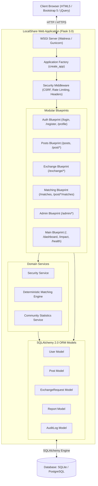
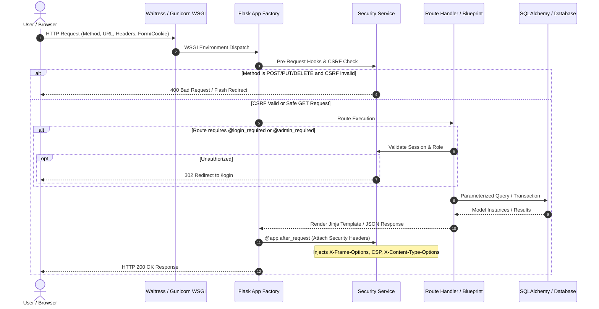
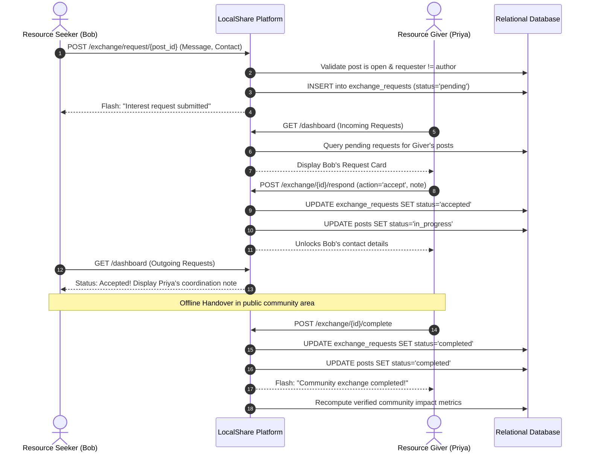

# System Architecture Document (SAD) — LocalShare

**Document Identifier:** SAD-LS-2026-V2.0  
**Status:** Implemented & Verified Architecture  
**Architect:** Antigravity Principal Systems Architect  
**System Version:** LocalShare Production v2.0.0  

---

## 1. Architecture Overview & Rationale

LocalShare is architected as a **modular monolith** using the **Application Factory pattern** in Flask. 

### Why a Modular Monolith?
1. **Appropriate Complexity:** A community mutual aid platform does not require distributed microservices complexity, network hops, or distributed transactions. A modular monolith provides single-process simplicity, zero inter-service network overhead, atomic database transactions, and simple deployment.
2. **Clear Separation of Concerns:** Business domains are partitioned into dedicated Flask Blueprints (`auth`, `posts`, `exchange`, `matching`, `admin`, `main`), supported by service layers (`security_service`, `matching_service`, `stats_service`) and domain models (`User`, `Post`, `ExchangeRequest`, `Report`, `AuditLog`).
3. **Database Flexibility:** Powered by SQLAlchemy 2.0 ORM, the application seamlessly supports lightweight single-file SQLite storage for local development and high-concurrency PostgreSQL in production without code modifications.

---

## 2. Technology Stack & Justification

| Layer | Selected Technology | Version | Architectural Justification |
| :--- | :--- | :--- | :--- |
| **Backend Runtime** | Python | 3.13.7 | Modern language runtime with type hint support, strong standard library, and robust security posture. |
| **Web Framework** | Flask | 3.0.0 / 3.0.3 | Lightweight WSGI micro-framework allowing precise architectural control, minimal overhead, and blueprint modularity. |
| **ORM Layer** | SQLAlchemy / Flask-SQLAlchemy | 2.1.4 / 3.1.1 | Enterprise-grade ORM providing clean relationship mapping, parameterized SQL injection prevention, and dialect abstraction. |
| **Migrations** | Flask-Migrate / Alembic | 4.1.0 / 1.20.0 | Declarative database schema tracking and evolution for production migrations. |
| **WSGI Server** | Waitress (Win/POSIX) / Gunicorn (POSIX) | 3.0.2 | High-performance multi-threaded production WSGI server without development-server vulnerabilities. |
| **Template Engine** | Jinja2 | 3.1.6 | Fast, secure template engine with automatic context-sensitive HTML escaping mitigating XSS. |
| **Frontend Styling** | Bootstrap & Bootstrap Icons | 5.3.0 / 1.10.5 | Accessible responsive grid system, high-contrast components, and clean modern aesthetic. |
| **Test Runner** | pytest & pytest-cov | 9.1.1 / 7.1.0 | Fast test execution with fixture isolation, parameterized testing, and coverage analytics. |

---

## 3. Architecture Diagrams

### 3.1 Container & Component Architecture

---

### 3.2 Request Lifecycle & Security Middleware Flow

---

### 3.3 User-to-User Handover Sequence

---

## 4. Configuration & Secrets Management

Configuration is strictly separated across three environments:
1. `DevelopmentConfig`: Uses local `localshare.db`, enables debugging, disables secure-only cookies for localhost HTTP.
2. `TestingConfig`: Uses in-memory SQLite (`sqlite:///:memory:`), disables CSRF token enforcement for fast HTTP client assertions, isolated sessions.
3. `ProductionConfig`: Enforces environment-injected `SECRET_KEY`, `DATABASE_URL` (PostgreSQL or persistent SQLite), enforces `SESSION_COOKIE_SECURE = True`, and disables debug mode completely.

---

## 5. Backup & Recovery Strategy

1. **SQLite Database Backup:**
   - Atomic hot backup using SQLite Online Backup API: `sqlite3 localshare.db ".backup 'backups/localshare_$(date +%Y%m%d_%H%M%S).db'"`
   - Daily automated cron job retained for 30 rolling days.
2. **PostgreSQL Backup:**
   - Logical dump via `pg_dump -Fc localshare_prod > backup.dump`
3. **Restoration Verification:**
   - Run test restore command into a scratch database: `sqlite3 scratch.db ".restore 'backups/backup.db'"`
   - Run automated health test `python -m pytest tests/test_stats.py` to confirm schema integrity.
