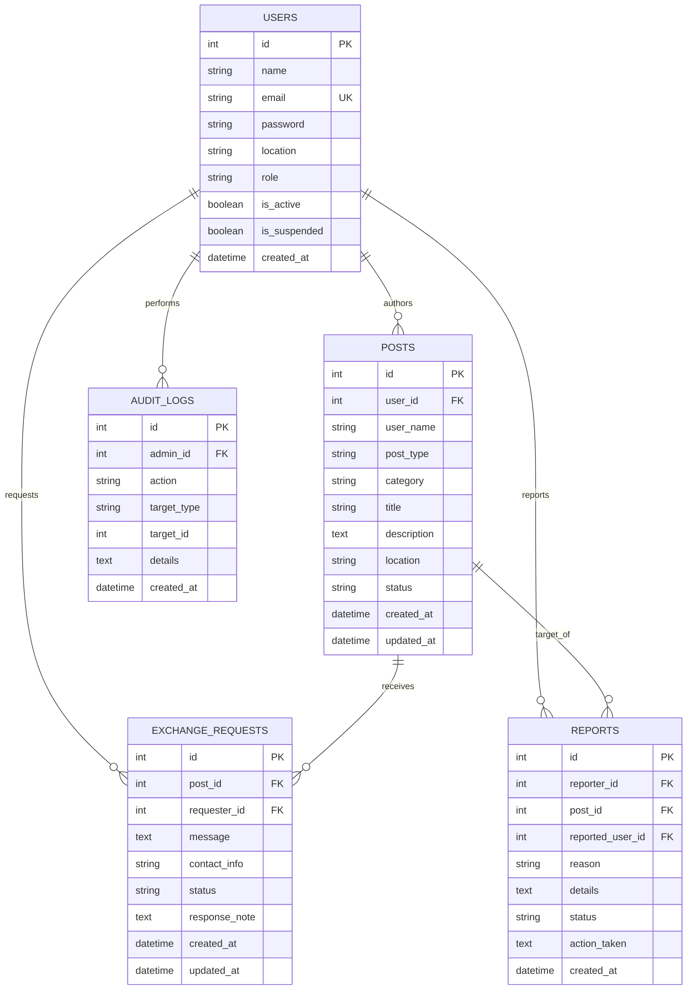

# Technical Design Document (TDD) — LocalShare

**Document Identifier:** TDD-LS-2026-V2.0  
**Status:** Implemented & Verified Implementation  
**System Version:** LocalShare Production v2.0.0  

---

## 1. Repository Structure & Package Responsibilities

```text
LocalShare-main/
├── app/
│   ├── __init__.py               # Application factory create_app(), CLI registrations
│   ├── config.py                 # Development, Testing, Production configurations
│   ├── extensions.py             # SQLAlchemy and Migrate singleton instances
│   ├── migrations_helper.py      # SQLite automatic database upgrade and password migration
│   ├── models/                   # SQLAlchemy 2.0 ORM domain entities
│   │   ├── __init__.py           # Re-exports domain entities
│   │   ├── user.py               # User model with Werkzeug password hashing & auto-upgrade
│   │   ├── post.py               # Post entity (offer/request, category, status lifecycle)
│   │   ├── exchange.py           # ExchangeRequest entity (handover negotiation & tracking)
│   │   ├── report.py             # Report entity for trust & safety moderation
│   │   └── audit.py              # AuditLog entity tracking admin governance actions
│   ├── auth/                     # Authentication & account management blueprint
│   │   ├── __init__.py
│   │   └── routes.py             # /register, /login, /logout, /profile
│   ├── posts/                    # Community post browsing & authoring blueprint
│   │   ├── __init__.py
│   │   └── routes.py             # /posts, /post/<id>, /post/new, /post/<id>/edit, /post/<id>/status
│   ├── exchange/                 # User-to-user mutual aid negotiation blueprint
│   │   ├── __init__.py
│   │   └── routes.py             # /exchange/request/<id>, /exchange/<id>/respond, /exchange/<id>/complete
│   ├── matching/                 # Deterministic smart matching engine
│   │   ├── __init__.py
│   │   ├── engine.py             # 100-point scoring formula, tokenization, Jaccard similarity
│   │   └── routes.py             # /matches, /post/<id>/matches
│   ├── admin/                    # Platform administration & moderation portal
│   │   ├── __init__.py
│   │   └── routes.py             # /admin, /admin/users, /admin/posts, /admin/reports, /admin/audit-logs
│   ├── main/                     # Core public pages blueprint
│   │   ├── __init__.py
│   │   └── routes.py             # /, /dashboard, /impact, /guidelines, /report/*, /health
│   └── services/                 # Cross-cutting domain services
│       ├── __init__.py
│       ├── security_service.py   # CSRF protection, sliding-window rate limiter, security headers
│       ├── matching_service.py   # Re-export of matching algorithms
│       └── stats_service.py      # Real-time database metrics calculator
├── static/
│   ├── css/style.css             # Enhanced responsive styles and focus rings
│   └── js/main.js                # Accessible jQuery validation & password strength meter
├── templates/                    # Jinja2 HTML5 semantic templates
│   ├── base.html                 # Main layout with responsive navbar, user dropdown, flash alerts
│   ├── index.html                # Hero landing, live stats strip, smart feature spotlight, recent posts
│   ├── posts.html                # Browse posts with search, category/type filter, sort, pagination
│   ├── post_detail.html          # Full post view, exchange form, lifecycle buttons, smart matches
│   ├── new_post.html             # Accessible post authoring form
│   ├── edit_post.html            # Post editing form
│   ├── login.html                # Login form with demo accounts
│   ├── register.html             # Registration form with password strength bar
│   ├── success.html              # Post publication confirmation
│   ├── dashboard.html            # User dashboard (My Posts, Incoming, Outgoing, Matches)
│   ├── impact.html               # Public verified impact dashboard & category progress bars
│   ├── guidelines.html           # Trust, safety, permitted items, and moderation rules
│   ├── report.html               # Post and user reporting form
│   ├── matches.html              # Matches dashboard
│   ├── post_matches.html         # Explainable match factor breakdown for single post
│   ├── profile.html              # Profile edit and password update forms
│   ├── admin/                    # Admin portal templates (index, users, posts, reports, audit_logs)
│   └── errors/                   # Custom error pages (400, 403, 404, 500)
├── tests/                        # Automated Pytest suite (34 passing tests, 72% coverage)
│   ├── conftest.py               # Fixtures, test client, isolated database
│   ├── test_auth.py              # Registration, login, hashing, session tests
│   ├── test_authorization.py     # Role boundaries, non-admin blocks, post ownership checks
│   ├── test_posts.py             # Post CRUD, validation, search, filter, pagination
│   ├── test_exchange_workflow.py # Full exchange lifecycle, duplicate checks, completion
│   ├── test_matching.py          # Deterministic formula, exclusions, tie-breaking
│   ├── test_security.py          # Security headers, rate limiting, plaintext upgrade, XSS escaping
│   ├── test_admin.py             # User suspension, post moderation, report resolution, audit log
│   └── test_stats.py             # Verified impact calculations, closed vs completed, health check
├── docs/                         # Comprehensive engineering and architectural documentation
├── app.py                        # Entry point for local development (`python app.py`)
├── wsgi.py                       # Production WSGI entry point for Waitress / Gunicorn
├── requirements.txt              # Production and testing dependency list
├── .env.example                  # Safe configuration template
├── .gitignore                    # Excludes virtualenvs, databases, secrets, caches
├── Dockerfile                    # Container definition
├── docker-compose.yml            # Multi-container definition with persistent storage
├── Procfile                      # Production process declaration
├── pytest.ini                    # Pytest configuration
└── README.md                     # Main project guide
```

---

## 2. Application Startup & Initialization Sequence

1. **Environment Load:** `app.py` or `wsgi.py` invokes `load_dotenv()` from `python-dotenv`.
2. **Factory Execution:** `create_app(config_name)` is invoked.
3. **Configuration Binding:** `app.config.from_object(config_by_name[config_name])` sets parameters.
4. **Extension Attachment:** `db.init_app(app)` and `migrate.init_app(app, db)` initialize SQLAlchemy and Alembic.
5. **Security Registration:**
   - Template context processor injects `csrf_token` generator (`inject_csrf_token`).
   - `@app.after_request` registers `add_security_headers`.
6. **Blueprint Registration:** All 6 blueprints (`auth_bp`, `posts_bp`, `exchange_bp`, `matching_bp`, `admin_bp`, `main_bp`) are mounted.
7. **Error Handlers:** Handlers for HTTP 400, 403, 404, and 500 are bound.
8. **Database Upgrade:** `upgrade_existing_sqlite_database()` inspects tables in `localshare.db`:
   - Adds missing columns (`role`, `is_active`, `is_suspended`, `updated_at`).
   - Hashes any legacy plaintext passwords.
   - Creates `exchange_requests`, `reports`, and `audit_logs` tables.
   - Ensures default admin account exists.

---

## 3. Database Entity Relationship Diagram (ERD)



---

## 4. Deterministic Smart Matching Algorithm

The matching algorithm (`app/matching/engine.py`) implements a deterministic mathematical scoring model yielding a score \( S \in [0, 100] \).

### 4.1 Scoring Formula
\[
S = W_{\text{type}} \cdot S_{\text{type}} + W_{\text{cat}} \cdot S_{\text{cat}} + W_{\text{kw}} \cdot S_{\text{kw}} + W_{\text{loc}} \cdot S_{\text{loc}}
\]

Where:
1. **Type Compatibility (\( W_{\text{type}} = 40 \)):**
   - \( S_{\text{type}} = 1.0 \) (40 pts) if \( (\text{type}_A = \text{'request'} \land \text{type}_B = \text{'offer'}) \lor (\text{type}_A = \text{'offer'} \land \text{type}_B = \text{'request'}) \)
   - \( S_{\text{type}} = 0.0 \) (0 pts) if \( \text{type}_A = \text{type}_B \).
2. **Category Relevance (\( W_{\text{cat}} = 30 \)):**
   - \( S_{\text{cat}} = 1.0 \) (30 pts) if \( \text{category}_A = \text{category}_B \).
   - \( S_{\text{cat}} = 0.0 \) (0 pts) if different.
3. **Keyword Overlap (\( W_{\text{kw}} = 20 \)):**
   - Let \( T_A, T_B \) be token sets extracted from title and description after lowercase conversion, punctuation stripping, and stopword removal.
   - Jaccard similarity \( J = \frac{|T_A \cap T_B|}{|T_A \cup T_B|} \).
   - If \( |T_A \cap T_B| > 0 \), \( S_{\text{kw}} = \min(20, \max(5, \text{round}(J \times 40))) \); else 0.
4. **Geographic Proximity (\( W_{\text{loc}} = 10 \)):**
   - 10 pts: Case-insensitive exact match of location strings.
   - 8 pts: Substring match (e.g., `'Hyderabad'` in `'Hyderabad, Banjara Hills'`).
   - 5 pts: Overlapping alphanumeric location tokens.
   - 0 pts: Distinct geographic areas.

### 4.2 Exclusion & Tie-Breaking Rules
- **Hard Exclusions:** \( S = 0 \) if candidate post status is not `'open'`, candidate user is suspended, or candidate author is identical to target author (\( \text{user\_id}_A = \text{user\_id}_B \)).
- **Minimum Recommendation Threshold:** \( S \ge 30 \).
- **Tie-Breaking:**
  1. Score descending (\( -S \))
  2. Timestamp descending (\( -\text{created\_at} \))
  3. Candidate ID ascending (\( +\text{id} \))
