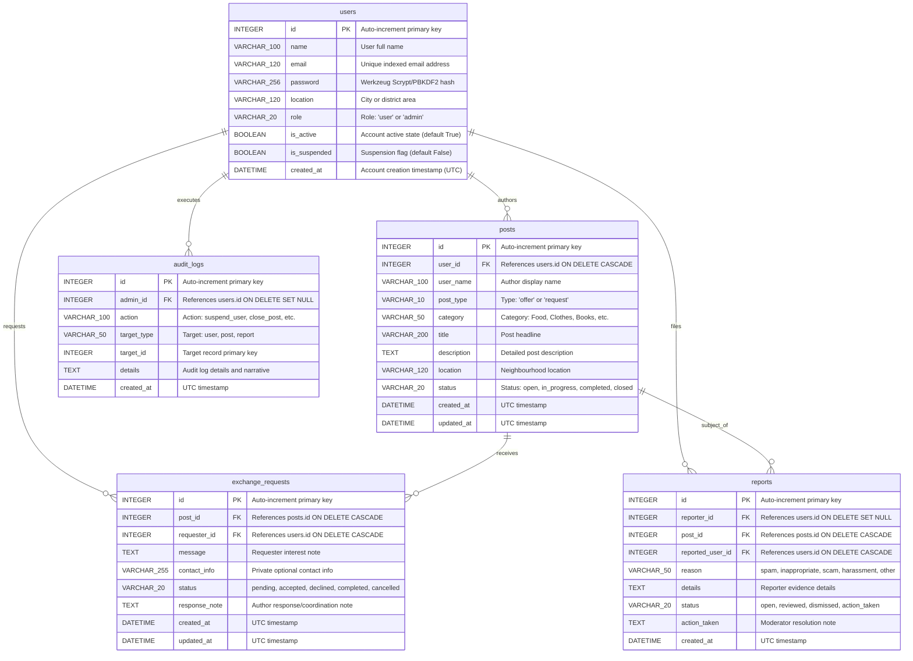

# Database Reference & Schema Manual — LocalShare

**Document Identifier:** DBR-LS-2026-V2.0  
**Database Engines Supported:** SQLite 3 (Development/Local) & PostgreSQL 14+ (Production)  
**Schema Version:** 2.0.0  

---

## 1. Schema Overview

The LocalShare database schema consists of five primary relational tables designed in Third Normal Form (3NF), enforcing referential integrity, foreign key cascades, unique constraints, and multi-column indexes for search optimization.

---

## 2. Table Definitions & Constraints

### 2.1 Table: `users`
| Column | Data Type | Nullable | Default | Constraints & Indexes | Description |
| :--- | :--- | :---: | :--- | :--- | :--- |
| `id` | `INTEGER` | NO | Auto | `PRIMARY KEY` | Unique user identifier |
| `name` | `VARCHAR(100)` | NO | None | None | User's full name |
| `email` | `VARCHAR(120)` | NO | None | `UNIQUE`, `INDEX` | User's email (stored lowercase) |
| `password` | `VARCHAR(256)` | NO | None | None | Securely hashed password |
| `location` | `VARCHAR(120)` | NO | None | None | General municipality / neighbourhood |
| `role` | `VARCHAR(20)` | NO | `'user'` | `INDEX` | Role (`'user'`, `'admin'`) |
| `is_active` | `BOOLEAN` | NO | `1` / `TRUE` | None | Account activity toggle |
| `is_suspended` | `BOOLEAN` | NO | `0` / `FALSE` | `INDEX` | Account moderation suspension |
| `created_at` | `DATETIME` | NO | `UTC NOW` | None | Account registration timestamp |

### 2.2 Table: `posts`
| Column | Data Type | Nullable | Default | Constraints & Indexes | Description |
| :--- | :--- | :---: | :--- | :--- | :--- |
| `id` | `INTEGER` | NO | Auto | `PRIMARY KEY` | Unique post identifier |
| `user_id` | `INTEGER` | NO | None | `FOREIGN KEY`, `INDEX` | References `users(id)` ON DELETE CASCADE |
| `user_name` | `VARCHAR(100)` | NO | None | None | Denormalized display name |
| `post_type` | `VARCHAR(10)` | NO | None | `CHECK (post_type IN ('offer','request'))`, `INDEX` | Type of post |
| `category` | `VARCHAR(50)` | NO | None | `INDEX` | Resource category |
| `title` | `VARCHAR(200)` | NO | None | None | Post headline |
| `description` | `TEXT` | NO | None | None | Detailed post description |
| `location` | `VARCHAR(120)` | NO | None | `INDEX` | Location for proximity calculations |
| `status` | `VARCHAR(20)` | NO | `'open'` | `INDEX` | Status: `open`, `in_progress`, `completed`, `closed` |
| `created_at` | `DATETIME` | NO | `UTC NOW` | `INDEX` | Creation timestamp |
| `updated_at` | `DATETIME` | YES | `NULL` | None | Last modification timestamp |

### 2.3 Table: `exchange_requests`
| Column | Data Type | Nullable | Default | Constraints & Indexes | Description |
| :--- | :--- | :---: | :--- | :--- | :--- |
| `id` | `INTEGER` | NO | Auto | `PRIMARY KEY` | Unique request identifier |
| `post_id` | `INTEGER` | NO | None | `FOREIGN KEY`, `INDEX` | References `posts(id)` ON DELETE CASCADE |
| `requester_id` | `INTEGER` | NO | None | `FOREIGN KEY`, `INDEX` | References `users(id)` ON DELETE CASCADE |
| `message` | `TEXT` | NO | None | None | Requester's explanation |
| `contact_info` | `VARCHAR(255)` | YES | `NULL` | None | Private optional contact information |
| `status` | `VARCHAR(20)` | NO | `'pending'` | `INDEX` | `pending`, `accepted`, `declined`, `completed`, `cancelled` |
| `response_note` | `TEXT` | YES | `NULL` | None | Post author's coordination reply |
| `created_at` | `DATETIME` | NO | `UTC NOW` | None | Submission timestamp |
| `updated_at` | `DATETIME` | YES | `NULL` | None | Last status change timestamp |

### 2.4 Table: `reports`
| Column | Data Type | Nullable | Default | Constraints & Indexes | Description |
| :--- | :--- | :---: | :--- | :--- | :--- |
| `id` | `INTEGER` | NO | Auto | `PRIMARY KEY` | Unique report identifier |
| `reporter_id` | `INTEGER` | YES | `NULL` | `FOREIGN KEY`, `INDEX` | References `users(id)` ON DELETE SET NULL |
| `post_id` | `INTEGER` | YES | `NULL` | `FOREIGN KEY`, `INDEX` | References `posts(id)` ON DELETE CASCADE |
| `reported_user_id` | `INTEGER` | YES | `NULL` | `FOREIGN KEY`, `INDEX` | References `users(id)` ON DELETE CASCADE |
| `reason` | `VARCHAR(50)` | NO | None | None | Reason: `spam`, `inappropriate`, etc. |
| `details` | `TEXT` | NO | None | None | Narrative of reported violation |
| `status` | `VARCHAR(20)` | NO | `'open'` | `INDEX` | `open`, `reviewed`, `dismissed`, `action_taken` |
| `action_taken` | `TEXT` | YES | `NULL` | None | Moderator notes |
| `created_at` | `DATETIME` | NO | `UTC NOW` | None | Filing timestamp |

### 2.5 Table: `audit_logs`
| Column | Data Type | Nullable | Default | Constraints & Indexes | Description |
| :--- | :--- | :---: | :--- | :--- | :--- |
| `id` | `INTEGER` | NO | Auto | `PRIMARY KEY` | Unique audit log ID |
| `admin_id` | `INTEGER` | YES | `NULL` | `FOREIGN KEY`, `INDEX` | References `users(id)` ON DELETE SET NULL |
| `action` | `VARCHAR(100)` | NO | None | `INDEX` | Action performed |
| `target_type` | `VARCHAR(50)` | NO | None | None | Target entity (`user`, `post`, `report`) |
| `target_id` | `INTEGER` | NO | None | None | ID of target entity |
| `details` | `TEXT` | YES | `NULL` | None | Descriptive audit narrative |
| `created_at` | `DATETIME` | NO | `UTC NOW` | `INDEX` | Execution timestamp |

---

## 3. Seed & Initial Accounts Reference

| User Name | Email | Password | Location | Role | Purpose |
| :--- | :--- | :--- | :--- | :--- | :--- |
| Priya Sharma | `priya@example.com` | `Test@123` | Hyderabad | `user` | Demo Resource Giver |
| Rahul Verma | `rahul@example.com` | `Test@123` | Hyderabad | `user` | Demo Resource Seeker |
| Platform Administrator | `admin@localshare.dev` | `Admin@123` | Hyderabad | `admin` | Administrative & Moderation Officer |
| Sneha (Existing User) | `psnehadeepika2006@gmail.com`| `Sneha@2006` | Guntur | `user` | Preserved Real Account (Hashed) |
