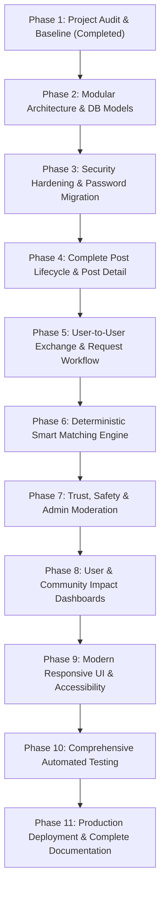

# LocalShare Project — Initial Technical Audit & Baseline Assessment

**Date of Audit:** October 16, 2026  
**Auditor:** Antigravity Senior Full-Stack & DevOps Engineering Lead  
**Target Repository:** LocalShare (`LocalShare-main`)  
**Audit Scope:** Codebase architecture, data models, security posture, UI/UX, testing status, and production readiness.

---

## 1. Executive Summary

LocalShare is a community resource-sharing web application originally implemented as a single-file Flask prototype (`app.py`, 227 lines) using raw SQLite (`sqlite3`) and server-rendered Jinja2 templates styled with Bootstrap 5.3.0 and custom CSS/jQuery.

While the existing prototype demonstrates basic proof-of-concept capabilities (user registration, login via session, creating offers/requests, filtering by type/category/location, and closing posts), it possesses critical security vulnerabilities (notably **plaintext password storage** and **hardcoded secret keys**), lacks foundational user-to-user interaction flows, has zero automated tests, and lacks the architecture required for production deployment or community scaling.

This document details the confirmed findings from inspecting every file in the repository, validates actual database state, ranks vulnerabilities, and establishes the phased engineering roadmap for production transformation.

---

## 2. Technology Stack & Architecture Baseline

### 2.1 Current Stack
| Component | Existing Implementation | Verified Details |
| :--- | :--- | :--- |
| **Backend Framework** | Flask 3.0.0 / 3.0.3 | Monolithic script in `app.py` |
| **Language Runtime** | Python 3.13.7 | 64-bit AMD64 Windows environment |
| **Database Engine** | SQLite 3 (`localshare.db`) | Raw `sqlite3` driver with `conn.row_factory = sqlite3.Row` |
| **ORM / Migrations** | None | Raw DDL (`CREATE TABLE IF NOT EXISTS`) embedded in `init_db()` |
| **Frontend Templates** | Jinja2 (HTML5) | 7 templates in `templates/` (`base.html`, `index.html`, etc.) |
| **Styling & Icons** | Bootstrap 5.3.0 + Bootstrap Icons 1.10.5 | CDN-hosted CSS with custom `static/css/style.css` |
| **Frontend Scripting**| jQuery 3.7.1 + `static/js/main.js` | Form validation and UI handlers |
| **Testing Suite** | **None** | Zero test files or test runner present |
| **WSGI / Server** | Werkzeug Development Server | `app.run(debug=True)` invoked on `__main__` |

### 2.2 Application Structure
```text
LocalShare-main/
├── app.py                (227 lines - entire backend logic, config, routes, DB access)
├── localshare.db         (SQLite database file, 20 KB)
├── requirements.txt      (Only contains 'Flask==3.0.3')
├── README.md             (High-level setup instructions)
├── LICENSE               (MIT License)
├── .gitignore            (Standard gitignore)
├── static/
│   ├── css/style.css     (103 lines - custom theming)
│   └── js/main.js        (108 lines - jQuery form validation)
└── templates/
    ├── base.html         (Base layout with navbar and footer)
    ├── index.html        (Landing hero, stats, recent posts)
    ├── login.html        (Login form)
    ├── register.html     (Registration form)
    ├── new_post.html     (Post creation form)
    ├── posts.html        (Post browsing & filtering)
    └── success.html      (Post published confirmation)
```

---

## 3. Database Schema & Data State Analysis

Inspection of the actual database file (`localshare.db`) revealed two tables: `users` and `posts`.

### 3.1 `users` Table
- **Columns:** `id INTEGER PRIMARY KEY`, `name TEXT`, `email TEXT UNIQUE`, `password TEXT`, `location TEXT`, `created_at TEXT`.
- **Confirmed Records:**
  1. `id=1, name='Priya Sharma', email='priya@example.com', password='Test@123', location='Hyderabad'`
  2. `id=2, name='Rahul Verma', email='rahul@example.com', password='Test@123', location='Hyderabad'`
  3. `id=3, name='sneha', email='psnehadeepika2006@gmail.com', password='Sneha@2006', location='guntur'`
- **Critical Finding:** Passwords for all accounts (both seeded demo users and real user `sneha`) are stored in **plaintext**.

### 3.2 `posts` Table
- **Columns:** `id`, `user_id`, `user_name`, `post_type` (CHECK `'request'|'offer'`), `category`, `title`, `description`, `location`, `status` (`'open'`), `created_at`.
- **Confirmed Records:** 4 posts exist across Food, Books, and Clothes categories.
- **Structural Deficiencies:**
  - Foreign key constraint is declared (`FOREIGN KEY (user_id) REFERENCES users(id)`), but SQLite does not enforce foreign keys unless `PRAGMA foreign_keys = ON;` is explicitly executed per connection.
  - Redundant denormalization: `user_name` is duplicated into `posts`.
  - Missing indexes on query filters: `posts(status, post_type, category, location)`.
  - No exchange requests, messages, reports, or audit tables exist.

---

## 4. Confirmed Bugs, Vulnerabilities, & Deficiencies

### 4.1 Critical Severity (Blockers for Public Deployment)
1. **Plaintext Password Storage:**
   - *Confirmed in:* `app.py:53-58`, `app.py:108-114`, `app.py:127-130`.
   - *Impact:* Complete exposure of user credentials in case of database leakage or read-access vulnerability.
   - *Remediation:* Implement Werkzeug password hashing (`generate_password_hash`, `check_password_hash`) using PBKDF2:SHA256 or Scrypt. Implement automated migration to hash existing plaintext passwords on first login or database initialization.
2. **Hardcoded Flask Secret Key:**
   - *Confirmed in:* `app.py:6`: `app.secret_key = 'localshare_sqlite_secret_2024'`.
   - *Impact:* Any attacker knowing or guessing the secret key can forge session cookies and impersonate any user or admin.
   - *Remediation:* Load `SECRET_KEY` from environment variables, falling back to a cryptographically secure random token only in local development.
3. **Debug Mode Enabled by Default:**
   - *Confirmed in:* `app.py:226`: `app.run(debug=True)`.
   - *Impact:* Exposes the Werkzeug interactive debugger in unhandled exceptions, enabling arbitrary code execution on the server.
   - *Remediation:* Enforce environment-driven configuration; disable debug in production; run under a production WSGI server (Gunicorn).

### 4.2 High Severity
1. **Absence of CSRF (Cross-Site Request Forgery) Protection:**
   - *Confirmed in:* All forms (`register.html`, `login.html`, `new_post.html`, `posts.html`).
   - *Impact:* Malicious third-party sites can submit requests on behalf of authenticated users.
   - *Remediation:* Integrate Flask-WTF / WTForms or implement signed CSRF tokens validated on all state-changing HTTP methods.
2. **State-Changing GET Request for Closing Posts:**
   - *Confirmed in:* `app.py:208-220`: `@app.route('/post/close/<int:post_id>')` listens only on `GET`.
   - *Impact:* Trivial CSRF vulnerability; clicking an external link or loading a malicious `` closes user posts unintentionally.
   - *Remediation:* Convert post state updates (close, reopen, complete, delete) to `POST` routes with CSRF token verification.
3. **Insecure Session Cookie Configuration:**
   - *Confirmed in:* Default Flask cookies without `SESSION_COOKIE_HTTPONLY`, `SESSION_COOKIE_SECURE`, or `SESSION_COOKIE_SAMESITE='Lax'`.
   - *Impact:* Session hijacking via client-side script access or cross-origin requests.
   - *Remediation:* Explicitly configure secure session cookies in the application config.
4. **No Rate Limiting on Authentication Endpoints:**
   - *Confirmed in:* `app.py:100` and `app.py:122`.
   - *Impact:* Susceptible to automated credential stuffing and brute-force password guessing.
   - *Remediation:* Introduce login rate limiting (e.g. Flask-Limiter or in-memory sliding window).

### 4.3 Medium Severity
1. **Missing Backend Validation & Sanitization:**
   - Backend only calls `.strip()` on strings. It lacks string length limits, category whitelist checks, and email format verification.
   - Bypassing frontend jQuery validation allows arbitrary long strings or illegal categories into the database.
2. **Missing Authorization Boundaries:**
   - Non-authenticated visitors can view posts, but there is no post detail route (`/post/<id>`), no post edit route, and no post deletion route.
   - No user roles exist (standard user vs administrator).
3. **Lack of Security Response Headers:**
   - No headers for `X-Frame-Options`, `X-Content-Type-Options`, `Referrer-Policy`, or `Content-Security-Policy`.
4. **Missing Pagination & Search Scalability:**
   - `SELECT * FROM posts WHERE status='open'` loads all matching rows without `LIMIT`/`OFFSET` pagination, posing severe performance degradation as posts grow.

### 4.4 Low Severity / Code Quality
1. **Monolithic Architecture:** All components reside in a single 227-line file without modular blueprints.
2. **jQuery Flash Dismissal Behavior:** Alerts automatically fade out after 4 seconds, causing readability issues for assistive technology or slow readers.
3. **Lack of Automated Testing:** Zero automated test coverage.

---

## 5. UI/UX & Accessibility Review

| Screen | Current Implementation | Issues Identified | Planned Upgrades |
| :--- | :--- | :--- | :--- |
| **Home (`/`)** | Hero, 3 basic counters, "How it works", recent 6 posts | Counters hardcoded to basic counts; no smart recommendations; no direct call to action for matched posts | Dynamic metrics, clear mission statement, smart match preview, accessible typography and contrast |
| **Browse (`/posts`)** | 3 dropdown filters (type, category, location text); responsive grid | No keyword search across title/description; no sorting (newest/oldest); no pagination; no post detail modal or page | Keyword search bar, sorting options, pagination controls, post detail link, clear status badges |
| **Post Detail** | **Does not exist** | Users cannot inspect full post descriptions or take direct action on a specific post | Dedicated `/post/<id>` page with author info, exchange request form, report button, and status history |
| **User Dashboard** | **Does not exist** | Users cannot see their active posts, incoming requests, or outgoing exchange requests in one place | Comprehensive `/dashboard` with tabs: My Posts, Incoming Requests, Outgoing Requests, Profile Settings |
| **Admin Dashboard** | **Does not exist** | No moderation interface for reports, user bans, or post removal | `/admin` portal with system stats, user management, post moderation, report resolution, and audit logs |

---

## 6. Functional Requirements Gap Matrix

| Requirement Area | Prompt Requirement | Current Status | Gap Description |
| :--- | :--- | :--- | :--- |
| **Auth & Accounts** | Hashed passwords, roles, status, profile edit | **Partial / Insecure** | Plaintext passwords, no roles, no profile editing, no rate limiting |
| **Offers & Requests** | Full lifecycle (create, edit, delete, close, reopen, complete) | **Partial** | Only create and close (via GET); no edit, reopen, complete, or delete |
| **User-to-User Flow** | Express interest, accept/reject, coordinate, complete exchange | **Missing (0%)** | No mechanism for users to interact or exchange resources |
| **Smart Local Matching**| Deterministic scoring algorithm with explainable factors | **Missing (0%)** | No matching engine exists |
| **Trust & Safety** | Report post/user, admin moderation queue, user suspension | **Missing (0%)** | No reporting, moderation, or audit logs |
| **Community Impact** | Metrics on completed exchanges, pending requests, categories | **Minimal (10%)** | Only simple counts of users and open posts on homepage |
| **Admin Controls** | Role enforcement, user management, content moderation | **Missing (0%)** | No admin role or dashboard exists |
| **Automated Tests** | Pytest suite covering auth, authz, posts, matching, security | **Missing (0%)** | Zero test files exist |
| **Production Config** | WSGI entry point, environment variables, security headers | **Missing (0%)** | Hardcoded secrets and development server execution |

---

## 7. Phased Implementation Plan



### Phase Details:
- **Phase 2: Modular Monolith Refactoring**
  - Restructure project into an application factory pattern (`app/` package) with Blueprints: `auth`, `main`, `posts`, `requests`, `matching`, and `admin`.
  - Introduce SQLAlchemy models and migrations while supporting both SQLite (dev) and PostgreSQL (prod).
- **Phase 3: Security & Credential Migration**
  - Implement Werkzeug secure hashing with backwards-compatible plaintext upgrade (on first login or migration script).
  - Add CSRF protection across all forms via signed tokens.
  - Implement login rate limiting, session security configurations, and HTTP security headers.
- **Phase 4: Post Lifecycle Management**
  - Add post detail (`/post/<id>`), editing (`/post/<id>/edit`), deletion (`/post/<id>/delete`), reopening, and status transitions (`open`, `in_progress`, `completed`, `closed`).
  - Add search, sorting, and pagination.
- **Phase 5: User-to-User Exchange Workflow**
  - Create `ExchangeRequest` entity with statuses (`pending`, `accepted`, `declined`, `completed`, `cancelled`).
  - Safe coordination contact mechanism between matched participants.
  - Exchange completion verification updating community metrics.
- **Phase 6: Deterministic Smart Matching Engine**
  - Scoring formula integrating category match, keyword similarity, location proximity, and complementary post types (`offer` vs `request`).
  - Explainable match factor breakdown and tie-breaking.
- **Phase 7: Trust, Safety, & Administration**
  - Create `Report` and `AuditLog` entities.
  - Report post and report user interfaces.
  - Admin dashboard with user ban/unban, post moderation, and audit review.
- **Phase 8: User & Community Dashboards**
  - Build user dashboard (`/dashboard`) and public community impact dashboard (`/impact`).
- **Phase 9: UI & Accessibility Polish**
  - Responsive layouts, focus indicators, keyboard accessibility, semantic HTML5, clear status badges, confirmation modals.
- **Phase 10: Automated QA Test Suite**
  - Pytest suite covering all functional, security, authorization, and matching requirements.
- **Phase 11: Production Deployment & 13 Core Documents**
  - Create `wsgi.py`, Gunicorn configuration, `.env.example`, Docker setup, and the complete set of required documentation in `docs/`.
